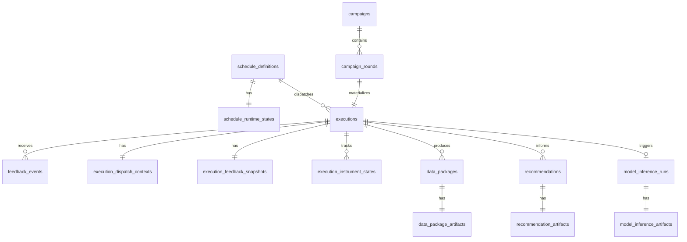

# 调度库三范式重构方案

## 1. 结论

当前 `smart_scheduler` 数据库不属于“完全遵守第三范式”的设计。

更准确地说：

- 调度核心主线有一部分接近 3NF
- 但闭环集成、审计日志、模型产物三块明显使用了反规范化设计
- 如果目标是“完全 3NF”，必须先区分：
  - 核心业务事实表
  - 状态缓存表
  - 审计事件表
  - 半结构化产物表

建议目标不是“所有表都强行 3NF”，而是：

- 核心事务表尽量做到 3NF
- 审计和产物表明确承认自己是反规范化快照，不参与核心约束推导

## 2. 当前设计的主要问题

### 2.1 `schedules` 混合了定义和运行状态

当前表定义见：

- [`models.py`](/Users/liye/Code/feed_back_sys/smart_scheduler/backend/app/models.py#L27)

同一张表里既有：

- 静态定义：`name`、`target`、`base_interval_seconds`
- 动态运行态：`dynamic_priority`、`health_score`、`consecutive_failures`、`awaiting_feedback`、`next_run_at`

其中：

- `dynamic_priority` 是计算结果，不是基础事实
- `awaiting_feedback` 可以由 execution 状态推导
- `health_score` 是反馈函数累计出来的状态量

这类字段不适合和调度定义放在同一表里。

### 2.2 `task_id` / `run_id` 只是别名冗余

当前多张表同时保存：

- `task_id`
- `run_id`
- `schedule_id`
- `execution_id`

实际数据已经证明：

- `data_packages.task_id = schedule_id`
- `data_packages.run_id = execution_id`
- `recommendation_records.task_id = schedule_id`
- `closed_loop_events.task_id = schedule_id`
- `closed_loop_events.run_id = execution_id`

也就是说，`task_id` / `run_id` 在库内不是独立实体，只是 API 术语别名。

### 2.3 `campaign.current_round` 是派生值

当前表定义见：

- [`models.py`](/Users/liye/Code/feed_back_sys/smart_scheduler/backend/app/models.py#L124)

`campaign.current_round` 实际可由该 campaign 下 execution 的最大 `experiment_round_index` 推导。

它更像缓存列，不是主事实。

### 2.4 `campaign_schedule_links` 实际是一对一，不是多对多

当前定义见：

- [`models.py`](/Users/liye/Code/feed_back_sys/smart_scheduler/backend/app/models.py#L144)

但其主键是 `schedule_id`，实际业务含义是：

- 一个 schedule 只能挂一个 campaign

当前数据也符合：

- 每个 `schedule_id` 只对应一个 `campaign_id`
- 每个 `campaign_id` 只对应一个 `schedule_id`

这种情况下，link 表不必要。

### 2.5 `data_packages` 过度承载

当前定义见：

- [`models.py`](/Users/liye/Code/feed_back_sys/smart_scheduler/backend/app/models.py#L155)

这张表同时承担了：

- 业务关联
- 上传记录
- 结构化结果
- 原始文件引用
- 调度器侧解析产物
- 标准化数据引用

并且其中大部分字段是 JSON：

- `raw_files_json`
- `metadata_json`
- `process_data_json`
- `result_data_json`
- `log_data_json`
- `scheduler_observation_json`
- `standard_data_ref_json`

这不是 3NF 问题，而是“单表承担太多责任”。

### 2.6 `feedback_observation` / `dispatch_payload` 成为隐式主表

当前执行状态高度依赖：

- `executions.dispatch_payload`
- `executions.feedback_observation`

表定义见：

- [`models.py`](/Users/liye/Code/feed_back_sys/smart_scheduler/backend/app/models.py#L72)

接口和前端大量直接读取这两个 JSON：

- [`schemas.py`](/Users/liye/Code/feed_back_sys/smart_scheduler/backend/app/schemas.py#L150)
- [`app-options.js`](/Users/liye/Code/feed_back_sys/smart_scheduler/ui/src/app-options.js#L64)

这会导致：

- 事实边界不清
- 状态难以约束
- 多处逻辑必须靠 JSON 合成

### 2.7 `closed_loop_events` 是审计表，但被混用为业务关联表

当前定义见：

- [`models.py`](/Users/liye/Code/feed_back_sys/smart_scheduler/backend/app/models.py#L253)

这张表本来适合做 append-only 事件流，但现在同时冗余挂了：

- `campaign_id`
- `schedule_id`
- `execution_id`
- `data_package_id`
- `recommendation_id`
- `task_id`
- `run_id`

如果它是审计表，这种冗余是可接受的。  
但如果还想让它承担主数据关系，就不满足 3NF。

## 3. 目标原则

### 3.1 严格遵守 3NF 的范围

以下对象应尽量做到 3NF：

- 调度定义
- 调度运行态
- campaign / round
- execution
- 仪器上传状态
- 数据包主记录
- recommendation 主记录
- model inference 主记录

### 3.2 明确允许反规范化的范围

以下对象不要求 3NF：

- 审计事件表
- 模型原始产物快照
- 原始 JSON payload 快照
- 外部系统引用快照

这些表只用于：

- 回放
- 审计
- 调试
- 前端详情展示

不作为主业务状态来源。

## 4. 建议的目标表结构

## 4.1 `schedule_definitions`

保存调度的静态定义。

字段建议：

- `id`
- `name`
- `description`
- `target`
- `base_interval_seconds`
- `min_interval_seconds`
- `max_interval_seconds`
- `retry_delay_seconds`
- `feedback_timeout_seconds`
- `max_consecutive_failures`
- `base_priority`
- `created_at`
- `updated_at`

去掉：

- `dynamic_priority`
- `health_score`
- `consecutive_failures`
- `awaiting_feedback`
- `next_run_at`
- `last_dispatched_at`
- `feedback_deadline_at`

## 4.2 `schedule_runtime_states`

保存 schedule 的当前运行态，一条 schedule 一条运行态。

字段建议：

- `schedule_id` PK/FK
- `status`
- `dynamic_priority`
- `health_score`
- `consecutive_failures`
- `awaiting_feedback`
- `next_run_at`
- `last_dispatched_at`
- `feedback_deadline_at`
- `updated_at`

说明：

- 这张表本质是缓存/状态表
- 运行态和定义解耦

## 4.3 `campaigns`

字段建议：

- `id`
- `name`
- `objective`
- `stop_condition`
- `max_round`
- `global_status`
- `created_at`
- `updated_at`

去掉：

- `current_round`
- `metadata_json`

如果确实需要元信息，可拆成：

- `campaign_metadata`

## 4.4 `campaign_rounds`

新增，一轮一行。

字段建议：

- `id`
- `campaign_id`
- `round_index`
- `schedule_id`
- `execution_id`
- `experiment_batch_id`
- `status`
- `started_at`
- `completed_at`

约束建议：

- `unique(campaign_id, round_index)`
- `unique(execution_id)`

这样：

- `campaign.current_round` 可以废掉
- 批次轮次关系变成显式事实，不再从 JSON 猜

## 4.5 `schedule_campaigns`

如果业务确认永远是 1:1：

- 直接在 `schedule_definitions` 上加 `campaign_id unique`

如果将来可能扩展：

- 保留 link 表
- 但改成标准复合主键：`(schedule_id, campaign_id)`

当前业务看，更建议直接一对一唯一外键。

## 4.6 `executions`

保留 execution 主事实，但去掉大 JSON 主导。

字段建议：

- `id`
- `schedule_id`
- `campaign_round_id`
- `scheduled_for`
- `dispatched_at`
- `closed_at`
- `attempt`
- `status`
- `feedback_score`
- `latency_ms`
- `note`
- `created_at`
- `updated_at`

从主表中拆出去：

- `dispatch_payload`
- `feedback_observation`

## 4.7 `execution_dispatch_contexts`

新增，保存派发时上下文快照。

字段建议：

- `execution_id` PK/FK
- `experiment_batch_id`
- `experiment_round_index`
- `sample_batch`
- `sample_id`
- `workflow_name`
- `measurement_metric`
- `target_metric_value`
- `dispatch_payload_json`
- `created_at`

说明：

- 如果短期改动成本低，也可以先只保留 `dispatch_payload_json`
- 但最少要把高频查询字段拆出来

## 4.8 `execution_feedback_snapshots`

新增，保存 execution 级反馈快照。

字段建议：

- `execution_id` PK/FK
- `closed_loop_ready`
- `current_step`
- `completed_count`
- `total_steps`
- `completion_ratio`
- `feedback_observation_json`
- `updated_at`

说明：

- 前端不该直接读 execution 主表的大 JSON
- 应该读结构化快照 + 明确状态表

## 4.9 `execution_instrument_states`

这是本次重构最重要的新表。

字段建议：

- `id`
- `execution_id`
- `instrument_code`
- `component_id`
- `status`
- `triggered_at`
- `uploaded_at`
- `parsed_at`
- `failed_at`
- `error_message`
- `batch_status_summary`
- `created_at`
- `updated_at`

约束建议：

- `unique(execution_id, instrument_code)`

状态建议：

- `pending`
- `triggered`
- `uploaded`
- `parsed`
- `failed`

这张表落地后：

- `feedback_observation.instrument_uploads` 可以退化为缓存或彻底取消
- 前端节点状态可直接读表，不再解析 JSON

## 4.10 `data_packages`

只保留数据包主事实。

字段建议：

- `id`
- `execution_id`
- `instrument_code`
- `component_id`
- `package_kind`
- `template_id`
- `template_version`
- `validation_status`
- `manage_db_record_id`
- `sample_id`
- `created_at`
- `updated_at`

去掉：

- `campaign_id`
- `schedule_id`
- `task_id`
- `run_id`
- 大量 JSON 列

因为这些都能通过 `execution_id` 关联取得。

## 4.11 `data_package_artifacts`

新增，保存半结构化产物。

字段建议：

- `data_package_id` PK/FK
- `experiment_batch_id`
- `raw_files_json`
- `metadata_json`
- `process_data_json`
- `result_data_json`
- `log_data_json`
- `scheduler_observation_json`
- `standard_data_ref_json`
- `note`
- `updated_at`

说明：

- 允许反规范化
- 但不污染主记录表

## 4.12 `recommendations`

保存 recommendation 主记录。

字段建议：

- `id`
- `schedule_id`
- `source_execution_id`
- `confidence`
- `summary`
- `model_id`
- `model_version`
- `input_dataset_version`
- `approval_status`
- `fingerprint`
- `created_at`
- `updated_at`

去掉：

- `campaign_id`
- `task_id`

这两项都能由 `schedule_id` 推导。

## 4.13 `recommendation_artifacts`

新增。

字段建议：

- `recommendation_id` PK/FK
- `latest_outcome`
- `rationale_json`
- `suggested_payload_json`
- `updated_at`

## 4.14 `model_inference_runs`

保留这张表，但只保留主状态。

字段建议：

- `id`
- `source_execution_id`
- `recommendation_id`
- `dispatched_execution_id`
- `status`
- `scheduled_for`
- `started_at`
- `completed_at`
- `dispatched_at`
- `summary`
- `error`
- `created_at`
- `updated_at`

去掉：

- `schedule_id`

因为可由 `source_execution_id -> executions.schedule_id` 推导。

## 4.15 `model_inference_artifacts`

新增。

字段建议：

- `model_inference_run_id` PK/FK
- `result_payload_json`
- `stored_result_path`
- `updated_at`

## 4.16 `feedback_events`

继续保留。

如果要更规范，可拆：

- `feedback_events`
- `feedback_event_artifacts`

但优先级不如前面的表高。

## 4.17 `closed_loop_events`

保留为审计表，不参与核心主数据建模。

建议：

- 明确标记为 append-only
- 不再要求它完全 3NF
- 允许保留冗余上下文方便追踪

也就是说：

- 它可以继续保留 `payload_json`
- 但业务代码不应再依赖它反推核心状态

## 5. 目标依赖关系

可以收敛成这条主线：

## 6. 对现有接口的影响

### 6.1 `/api/v1/executions`

当前输出强依赖：

- `dispatch_payload`
- `feedback_observation`

未来建议改为聚合：

- `execution`
- `execution_dispatch_context`
- `execution_feedback_snapshot`
- `execution_instrument_states`
- `model_inference_run`

API 层再拼成现有响应结构，兼容前端。

### 6.2 `/api/v1/closed-loop/data-packages`

当前既写：

- `data_packages`
- `scheduler_observation_json`
- `execution.feedback_observation`

未来建议：

- 主写 `data_packages`
- 更新 `execution_instrument_states`
- 更新 `execution_feedback_snapshots`
- JSON 快照只进 artifacts 表

### 6.3 前端状态来源

前端现在大量依赖：

- `feedback_observation.instrument_uploads`
- `feedback_observation.workflow_progress`

未来应改成：

- 节点状态读 `execution_instrument_states`
- 流程进度读 `execution_feedback_snapshots`
- 模型状态读 `model_inference_runs`

## 7. 迁移顺序

建议分四期，不要一次重做。

### 第 1 期：引入结构化状态表，不删旧字段

新增：

- `schedule_runtime_states`
- `campaign_rounds`
- `execution_dispatch_contexts`
- `execution_feedback_snapshots`
- `execution_instrument_states`
- `data_package_artifacts`
- `recommendation_artifacts`
- `model_inference_artifacts`

同时保留旧 JSON 字段，双写一段时间。

### 第 2 期：前端和接口切换到新结构

接口层改为优先读新表：

- `/api/v1/executions`
- `/api/v1/runs/{run_id}`
- `/api/v1/recommendations`

前端不再以 `feedback_observation` 为主事实来源。

### 第 3 期：删除冗余别名列

移除：

- `data_packages.task_id`
- `data_packages.run_id`
- `data_packages.campaign_id`
- `recommendation_records.task_id`
- `recommendation_records.campaign_id`
- `model_inference_runs.schedule_id`

并把 `campaign_schedule_links` 收敛为一对一外键。

### 第 4 期：剥离旧 JSON 主字段

最终考虑移除或降级：

- `executions.dispatch_payload`
- `executions.feedback_observation`

若仍需保留，明确改名为：

- `dispatch_payload_snapshot_json`
- `feedback_observation_snapshot_json`

避免让人误以为它们是主数据来源。

## 8. 推荐的最小落地版本

如果你不想一次大改，最小且收益最大的版本是：

1. 新增 `execution_instrument_states`
2. 新增 `execution_feedback_snapshots`
3. 新增 `campaign_rounds`
4. 把 `data_packages` 的大 JSON 挪到 `data_package_artifacts`
5. 去掉所有 `task_id` / `run_id` 冗余列

做完这五步，库设计就会明显接近 3NF，而且前端状态也会稳定很多。

## 9. 建议的下一步

下一步最合适的不是直接“全库重写”，而是：

1. 先落 `execution_instrument_states`
2. 再落 `execution_feedback_snapshots`
3. 然后把 `/api/v1/executions` 切到新状态表输出

这样可以先解决现在最影响使用的问题：

- 节点状态不稳定
- JSON 状态来源混乱
- 同一事实在多处重复写入

